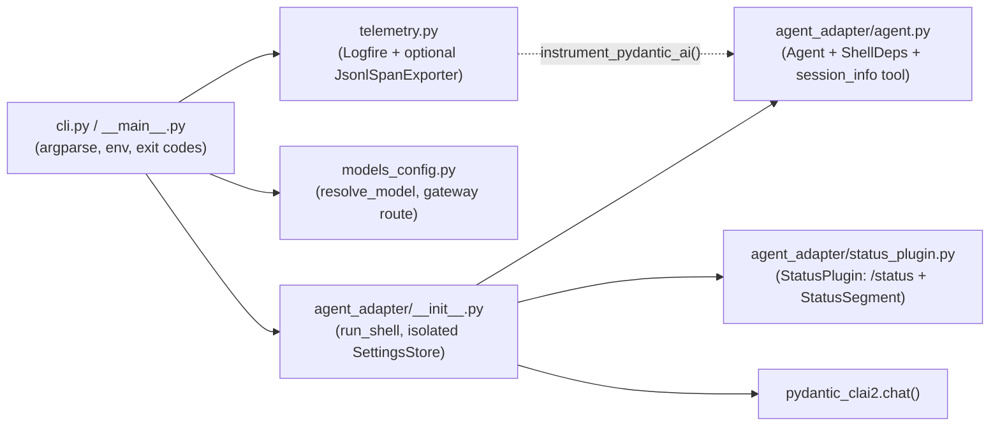

# `hello-pax` — Minimal `clai2` Shell with Logfire

Design and implementation plan for `hello-pax`, a minimal, isolated `pydantic-clai2` interactive terminal shell with Logfire-first telemetry, modeled on [`mdfranz/partex/src/partex`](https://github.com/mdfranz/partex/tree/main/src/partex).

---

## 1. Goals & Non-Goals

### Goals
- Provide a standalone `uv` Python **>=3.14** project rooted at `pax/hello-pax/`.
- Host a `pydantic-ai` `Agent` inside `pydantic-clai2`'s interactive terminal (`chat()`) using `partex`'s isolation boundaries:
  - Only `hello_pax.agent_adapter` imports `pydantic_clai2`.
  - Global CLAI2 preferences and stock coding/shell/filesystem plugins cannot bleed into the session (`CHAT_SETTINGS` pins `model=None`, `code_mode=False`, `speculative_code_mode=False`, `session_namer=False`; isolated `SettingsStore`; explicit `builtin_plugins`).
- Configure **Logfire-first** observability (`send_to_logfire='if-token-present'` by default, `console=False`, `logfire.instrument_pydantic_ai()`), with:
  - `--no-logfire` / `HELLO_PAX_LOGFIRE=0|false|off|no` to disable remote export;
  - `--logfire-content` / `HELLO_PAX_LOGFIRE_CONTENT=1` to opt into keeping GenAI prompt/reply/tool content out of Logfire's default secret scrubber while preserving scrubbing on all other attributes;
  - Optional local `0600` lazy JSONL span export via `--log-file PATH|auto|off` / `HELLO_PAX_LOG_FILE`.
- Wire **one minimal example agent tool** (`session_info` via `RunContext[ShellDeps]`) and **one minimal operator-only CLAI2 plugin** (`StatusPlugin` providing `/status` + status-bar segment via `ContextVar` + `builtin_plugins`) as tested extension templates.
- Port `partex`'s `resolve_model` model configuration: any `pydantic-ai` `provider:model` string (`google:`, `anthropic:`, `openai:`, `openrouter:`, `gateway/...`, `test`), bare model names with `--gateway-route` (including `PYDANTIC_AI_GATEWAY_BASE_URL` trailing-route normalization), and `--thinking`.
- Maintain a 100% hermetic test suite (`ruff`, `pyright` strict on Python 3.14, `pytest` with `TestModel`/`FunctionModel` and zero network/credentials).

### Non-Goals
- No security engine, SQLite run store, HTTP target client, HAR/nmap pipelines, skills registry, Monty `CodeMode`, web search sub-agent, or Gemini safety-override plumbing from `partex`.
- No host filesystem, shell execution, or coding tools exposed to the model.
- No `logfire.instrument_httpx()` (never capture raw HTTP client headers/credentials on transport spans).

---

## 2. Architecture & Invariants



### Hard Invariants
1. **Python >=3.14 floor**: `requires-python = ">=3.14"`, `.python-version = 3.14`, `ruff` `target-version = "py314"`, `pyright` `pythonVersion = "3.14"` (`typeCheckingMode = "strict"`). Use modern 3.14 syntax; never add `from __future__ import annotations`.
2. **CLAI2 import boundary**: Only modules under `src/hello_pax/agent_adapter/` may import `pydantic_clai2` (enforced by an AST test in `tests/test_agent.py`, matching `partex`).
3. **Module-level CLAI2 import**: `agent_adapter/__init__.py` imports `pydantic_clai2` at module level (preserving `partex`'s safeguard that CLAI2 registers framing tags before any text escaping runs).
4. **No TUI/telemetry collision**: `logfire.configure(..., console=False)` is always set so Logfire never writes to stdout/stderr while CLAI2 owns the terminal.
5. **Per-turn trace flushing**: Do **not** wrap `await chat(...)` in a single session-spanning OpenTelemetry span (which would not finish or export until the shell exits). Emit a lightweight `logfire.info('hello-pax session started', ...)` event at startup and let `logfire.instrument_pydantic_ai()` emit and flush an independent trace per agent turn.
6. **CLAI2 settings & request limit isolation**:
   - `CHAT_SETTINGS = Settings(model=None, code_mode=False, speculative_code_mode=False, session_namer=False)` prevents saved global preferences from overriding the agent's model, disables Code Mode, and disables CLAI2's session namer (which hard-codes a 250-token cap that fails on reasoning models and re-sends conversation content).
   - Pass explicit `usage_limits=UsageLimits(request_limit=request_limit)` (default `200`) to `chat()`, because `pydantic_clai2.chat()` does not apply CLAI2's CLI `request_limit` setting and would otherwise fall back to `pydantic-ai`'s default of `50`.
7. **Supply-chain cool-off**: Keep `partex`'s `[tool.uv] exclude-newer = "2 days"` with explicit per-package exemptions only for the `pydantic-ai` / `pydantic-clai2` / `pydantic-monty` stack. (For example, `logfire` `6.0.1` is <24h old at plan time, so `uv sync` locks battle-tested `logfire` `5.6.0` alongside `pydantic-clai2` `0.71.0` and `pydantic-ai-slim` `2.71.0`, matching `partex/uv.lock`.)
8. **Private permissions & zero secret leakage**: Any local state directories are created `0700`; JSONL trace files are created lazily on first span with mode `0600`. Credentials stay strictly in environment variables read by `pydantic-ai` / `logfire` and are never logged or stored.

---

## 3. Repository Layout

```text
pax/hello-pax/
├── .gitignore
├── .python-version              # 3.14
├── PLAN.md                      # This design & implementation plan
├── README.md                    # Quick start, CLI/env reference, extension guide
├── pyproject.toml               # uv + hatchling, Python >=3.14, ruff/pyright/pytest
├── src/
│   └── hello_pax/
│       ├── __init__.py          # Package docstring + package_version()
│       ├── __main__.py          # `python -m hello_pax` entry point
│       ├── cli.py               # argparse CLI, env resolution, exit codes, telemetry init
│       ├── errors.py            # HelloPaxError(Exception) with rule_code
│       ├── models_config.py     # resolve_model, normalize_gateway_base_url, ModelConfigError
│       ├── paths.py             # state_dir, mkdir_private (0700)
│       ├── telemetry.py         # Logfire-first configure_telemetry, JsonlSpanExporter, keep_content, announce
│       └── agent_adapter/       # ONLY package allowed to import pydantic_clai2
│           ├── __init__.py      # CHAT_SETTINGS, DEFAULT_REQUEST_LIMIT, shell_model_settings, run_shell
│           ├── agent.py         # ShellDeps, DEFAULT_INSTRUCTIONS, session_info tool, build_shell_agent
│           └── status_plugin.py # StatusControl, current_status ContextVar, StatusPlugin (/status + badge)
└── tests/
    ├── test_agent.py            # Agent build/tool execution + AST import-boundary check
    ├── test_cli.py              # CLI args, env fallback, exit codes, telemetry + run_shell wiring
    ├── test_models_config.py    # resolve_model, --gateway-route, base URL normalization, errors
    ├── test_status_plugin.py    # /status command, completions, status badge, unbound fallback
    └── test_telemetry.py        # Logfire-first defaults, --log-file, lazy 0600 JSONL, scrubbing, real Agent spans
```

---

## 4. Packaging & Tooling (`pax/hello-pax/pyproject.toml`)

```toml
[build-system]
requires = ["hatchling"]
build-backend = "hatchling.build"

[project]
name = "hello-pax"
version = "0.1.0"
description = "Minimal isolated pydantic-clai2 shell with Logfire telemetry"
requires-python = ">=3.14"
dependencies = [
    "anyio>=4",
    "logfire>=5.6",
    "opentelemetry-sdk>=1.30",
    "pydantic-ai-slim[google]>=2.68",
    "pydantic-clai2>=0.68",
    "rich>=14",
]

[project.scripts]
hello-pax = "hello_pax.__main__:main"

[tool.uv]
exclude-newer = "2 days"
exclude-newer-package = { pydantic-ai-slim = false, pydantic-graph = false, pydantic-ai-harness = false, pydantic-clai2 = false, pydantic-monty = false, pydantic-monty-client = false, pydantic-monty-runtime = false }

[dependency-groups]
dev = ["anyio", "pyright", "pytest", "ruff"]

[tool.hatch.build.targets.wheel]
packages = ["src/hello_pax"]

[tool.ruff]
include = ["*.py", "*.pyi", "pyproject.toml"]
line-length = 120
target-version = "py314"

[tool.ruff.format]
quote-style = "single"

[tool.pyright]
pythonVersion = "3.14"
typeCheckingMode = "strict"
include = ["src"]

[tool.pytest.ini_options]
anyio_mode = "auto"
testpaths = ["tests"]
```

---

## 5. Module Specifications

### 5.1 `src/hello_pax/__init__.py` & `src/hello_pax/__main__.py`
- `__init__.py`: defines `package_version() -> str` returning `importlib.metadata.version('hello-pax')` with `'0.1.0'` fallback on `PackageNotFoundError`.
- `__main__.py`: imports `main` from `.cli` and executes `raise SystemExit(main())` under `if __name__ == '__main__':`.

### 5.2 `src/hello_pax/errors.py`
- `HelloPaxError(Exception)`: carries `rule_code: str | None = None` for structured diagnostics and exit-code mapping (`cli.py` formats `hello-pax: <rule_code or "error">: <msg>` on stderr and exits `1`).

### 5.3 `src/hello_pax/paths.py`
- `STATE_DIR_ENV = 'HELLO_PAX_STATE_DIR'`
- `state_dir(env: Mapping[str, str] | None = None) -> Path`:
  - Pure (never creates directories).
  - Precedence: `$HELLO_PAX_STATE_DIR` (absolute) > `$XDG_STATE_HOME/hello-pax` (when absolute) > `~/.local/state/hello-pax`.
- `mkdir_private(directory: Path) -> None`: recursively creates missing parent directories with mode `0o700`, preserving modes of existing directories.

### 5.4 `src/hello_pax/models_config.py`
Ported from `partex/models_config.py` (omitting `partex`-specific `--search-model` and Gemini security-testing safety overrides):
- `GATEWAY_BASE_URL_ENV = 'PYDANTIC_AI_GATEWAY_BASE_URL'`
- `ModelConfigError(HelloPaxError)`: sets `rule_code='model-config'`.
- `is_model_string(model: str) -> bool`: `':' in model or model == 'test'`.
- `normalize_gateway_base_url(route: str, env: MutableMapping[str, str] | None = None) -> None`: strips trailing `/{route}` from `PYDANTIC_AI_GATEWAY_BASE_URL` so Gateway Connect URLs (`.../proxy/doubleword`) do not double-append the route.
- `resolve_model(model: str, *, gateway_route: str | None = None) -> Model | str`:
  - Strips whitespace; empty -> `ModelConfigError`.
  - Without `gateway_route`: requires `is_model_string(model)` (else `ModelConfigError`) and returns the string untouched (no network or credentials check yet; `Agent` uses `defer_model_check=True`).
  - With `gateway_route`: validates single non-empty route segment (no `/`), rejects already-prefixed model strings, calls `normalize_gateway_base_url(route)`, builds `gateway_provider('openai', route=route)` (translating `pydantic_ai.exceptions.UserError` to `ModelConfigError`), and returns `OpenAIChatModel(model, provider=provider)`.
- `model_display_name(model: Model | str) -> str`: returns `model` if `str`, else `model.model_name`.

### 5.5 `src/hello_pax/telemetry.py`
Logfire-first adaptation of `partex/telemetry.py`:
- Constants:
  - `LOGFIRE_ENV = 'HELLO_PAX_LOGFIRE'` (remote enabled by default; `'0'|'false'|'off'|'no'` disables)
  - `LOGFIRE_CONTENT_ENV = 'HELLO_PAX_LOGFIRE_CONTENT'` (`'1'|'true'|'on'|'yes'` opts into unscrubbed content)
  - `LOG_FILE_ENV = 'HELLO_PAX_LOG_FILE'`
  - `CONTENT_ATTRIBUTES = frozenset({'gen_ai.input.messages', 'gen_ai.output.messages', 'gen_ai.system_instructions', 'gen_ai.tool.call.arguments', 'gen_ai.tool.call.result', 'final_result'})`
- Functions & classes:
  - `resolve_remote_logfire(no_logfire: bool, env: Mapping[str, str] | None = None) -> bool`: `False` if `no_logfire` is `True` or `env.get(LOGFIRE_ENV)` (stripped/lowered) is in `{'0', 'false', 'off', 'no'}`; otherwise `True`.
  - `resolve_logfire_content(flag: bool, env: Mapping[str, str] | None = None) -> bool`: `True` if `flag` is `True` or `env.get(LOGFIRE_CONTENT_ENV)` (stripped/lowered) is in `{'1', 'true', 'on', 'yes'}`.
  - `resolve_log_path(cli_value: str | None, env: Mapping[str, str] | None = None) -> Path | None`:
    - Pure (never creates directories).
    - Precedence: `cli_value` (when not `None`) > `env.get(LOG_FILE_ENV)` > `None`.
    - Empty or in `{'off', 'none', '0', 'false'}` -> `None`.
    - `'auto'` -> `state_dir(env) / 'logs' / f'hello-pax-{UTC:%Y%m%dT%H%M%SZ}-{os.getpid()}.jsonl'`.
    - Otherwise -> `Path(value).expanduser()`.
  - `span_record(span: ReadableSpan) -> dict[str, Any]`: serializes `name`, hex `trace_id`/`span_id`/`parent_span_id`, ISO-8601 UTC `start`/`end`, `status`, `status_description`, `attributes`, and `events`.
  - `JsonlSpanExporter(SpanExporter)`: lazily creates parent dirs (`0700`) and file (`0600`) on first `export()`, appends JSONL lines, flushes every export, catches `OSError, ValueError` -> `SpanExportResult.FAILURE`, closes cleanly on `shutdown()`.
  - `keep_content(match: ScrubMatch) -> Any`: returns `match.value` iff `len(path) >= 2 and path[0] == 'attributes' and path[1] in CONTENT_ATTRIBUTES`, else `None`.
  - `configure_telemetry(*, log_path: Path | None, remote: bool, service_version: str, content: bool = False) -> None`:
    ```python
    import logfire

    processors = [] if log_path is None else [SimpleSpanProcessor(JsonlSpanExporter(log_path))]
    logfire.configure(
        service_name='hello-pax',
        service_version=service_version,
        send_to_logfire='if-token-present' if remote else False,
        console=False,
        additional_span_processors=processors,
        scrubbing=logfire.ScrubbingOptions(callback=keep_content) if content else None,
    )
    logfire.instrument_pydantic_ai()
    ```
  - `announce(log_path: Path | None, *, remote: bool) -> None`: writes one concise stderr line before CLAI2 takes over the terminal (nothing emitted if both `remote` is `False` and `log_path` is `None`).

### 5.6 `src/hello_pax/agent_adapter/agent.py`
- `@dataclass(frozen=True, slots=True, kw_only=True) class ShellDeps`:
  - `session_id: str`
  - `model_label: str`
  - `started_at: datetime`
  - `logfire_remote: bool`
  - `log_path: Path | None`
- `DEFAULT_INSTRUCTIONS`: concise assistant instructions noting `session_info` is available for inspecting session metadata.
- `session_info(ctx: RunContext[ShellDeps]) -> dict[str, str | bool | None]`: deterministic read-only tool returning `{'session_id': ..., 'model': ..., 'started_at': ..., 'logfire_remote': ..., 'log_path': ...}`. Exercises `RunContext` injection and produces real `gen_ai.tool.name == 'session_info'` spans in Logfire/JSONL.
- `build_shell_agent(model: Model | str, *, instructions: str | None = None, model_settings: ModelSettings | None = None) -> Agent[ShellDeps, str]`:
  - `Agent(model, name='hello_pax_shell_agent', deps_type=ShellDeps, output_type=str, instructions=instructions or DEFAULT_INSTRUCTIONS, tools=[session_info], model_settings=model_settings, defer_model_check=True)`.

### 5.7 `src/hello_pax/agent_adapter/status_plugin.py`
Follows `partex`'s `scope_plugin.py` + `targets_plugin.py` pattern (with `# pyright: ignore[reportMissingTypeStubs]` on `pydantic_clai2` imports):
- `STATUS_PLUGIN_ID = 'hello_pax_status'`
- `STATUS_PLUGIN_FACTORY = 'hello_pax.agent_adapter.status_plugin:StatusPlugin'`
- `SUBCOMMANDS = ('telemetry', 'model', '--help')`
- `@dataclass(frozen=True, slots=True) class StatusControl`:
  - Fields: `session_id: str`, `model_label: str`, `started_at: datetime`, `logfire_remote: bool`, `log_path: Path | None`, `request_limit: int`, `thinking: str | None = None`.
  - `status_segment(self) -> str`: synchronous, I/O-free badge for CLAI2's status row:
    - remote + log_path -> `'hello-pax · logfire+jsonl'`
    - remote only -> `'hello-pax · logfire'`
    - log_path only -> `'hello-pax · jsonl'`
    - neither -> `'hello-pax · telemetry:off'`
  - `completions(self, args: list[str]) -> tuple[str, ...]`: completes `SUBCOMMANDS` for the first argument.
  - `async def handle(self, args: list[str]) -> str`: handles `/status` (full summary), `/status telemetry`, `/status model`, `/status --help` / `-h`, and prints usage for unknown args. Purely operator-side; never sent to the model.
- `current_status: ContextVar[StatusControl | None] = ContextVar('hello_pax_status_control', default=None)`
- `class StatusPlugin(Plugin[NoSettings])`:
  - `get_capabilities(self) -> Sequence[Any]`: returns `()`.
  - `get_commands(self) -> Sequence[Command]`: returns `(Command(name='status', description=..., handler=control.handle, complete=control.completions),)` when `current_status.get()` is bound, else `()`.
  - `get_status_segments(self) -> Sequence[StatusSegment]`: returns `(control.status_segment,)` when bound, else `()`.

### 5.8 `src/hello_pax/agent_adapter/__init__.py`
- Module-level imports: `from pydantic_clai2 import chat`, `PluginSettings`, `Settings`, `SettingsStore` (with pyright ignores matching `partex`).
- `CHAT_SETTINGS = Settings(model=None, code_mode=False, speculative_code_mode=False, session_namer=False)`
- `DEFAULT_REQUEST_LIMIT = 200`
- `shell_model_settings(thinking: ThinkingLevel | None) -> ModelSettings | None`: returns `cast('ModelSettings', {'thinking': thinking})` if `thinking is not None` else `None`.
- `async def run_shell(...) -> str`:
  - Parameters: `model: Model | str`, `*, instructions: str | None = None`, `request_limit: int = DEFAULT_REQUEST_LIMIT`, `thinking: ThinkingLevel | None = None`, `logfire_remote: bool = True`, `log_path: Path | None = None`, `ephemeral: bool = False`, `state_root: Path | None = None`, `console: Console | None = None`.
  - Generates `session_id = f'pax_{uuid4().hex[:12]}'`, `started_at = datetime.now(UTC)`, `model_label = model_display_name(model)`.
  - Builds `ShellDeps`, `StatusControl`, and `agent = build_shell_agent(...)`.
  - When `logfire_remote or log_path is not None`, emits `logfire.info('hello-pax session started', session_id=session_id, model=model_label)`.
  - Resolves isolated `SettingsStore`:
    - `ephemeral=True`: `tempfile.TemporaryDirectory(prefix='hello-pax-clai2-')` -> `Path(tmp) / 'config.db'`.
    - `ephemeral=False`: `chat_dir = (state_root or state_dir()) / 'clai2'`; `mkdir_private(chat_dir)` -> `chat_dir / 'config.db'`.
  - Binds `current_status` via `try/finally` and awaits:
    ```python
    await chat(
        agent,
        deps=deps,
        load_plugins=True,
        store=SettingsStore(config_db),
        builtin_plugins=(PluginSettings(id=STATUS_PLUGIN_ID, factory=STATUS_PLUGIN_FACTORY),),
        console=console,
        settings=CHAT_SETTINGS,
        usage_limits=UsageLimits(request_limit=request_limit),
    )
    ```
  - Returns `session_id`.

### 5.9 `src/hello_pax/cli.py`
Single-command `argparse` interface (`prog='hello-pax'`):

| Flag | Env fallback | Default | Description |
| --- | --- | --- | --- |
| `-m`, `--model` | `HELLO_PAX_MODEL` | *(required)* | `pydantic-ai` model string (`google:...`, `anthropic:...`, `openai:...`, `gateway/...`, `test`) or bare name with `--gateway-route` |
| `-r`, `--gateway-route` | — | `None` | Pydantic AI Gateway route for a bare `--model` |
| `--thinking` | — | `None` | Reasoning effort: `minimal`, `low`, `medium`, `high`, `xhigh`, `max` |
| `--instructions` | — | `None` | Custom system prompt overriding `DEFAULT_INSTRUCTIONS` |
| `--request-limit` | — | `200` | Positive integer max model turns per operator prompt |
| `--ephemeral` | — | `False` | Use temporary CLAI2 `SettingsStore` instead of `<state_dir>/clai2/config.db` |
| `--no-logfire` | `HELLO_PAX_LOGFIRE=0\|off\|false\|no` | `False` (remote on) | Disable sending spans to Logfire (`send_to_logfire=False`) |
| `--logfire-content` | `HELLO_PAX_LOGFIRE_CONTENT=1\|true\|on` | `False` | Exempt `gen_ai.*` content attributes from Logfire's default secret scrubber |
| `--log-file` | `HELLO_PAX_LOG_FILE` | `None` | Optional local `0600` JSONL span log (`PATH`, `auto`, or `off`) |
| `--version` | — | — | Print `hello-pax <version>` and exit `0` |

Exit codes (matching `partex`):
- `0` (`EXIT_OK`): clean exit / `--version` / `--help`
- `1` (`EXIT_FATAL`): `HelloPaxError` (e.g., `ModelConfigError`)
- `2` (`EXIT_USAGE`): `argparse` usage error or missing `--model` + `$HELLO_PAX_MODEL`
- `130` (`EXIT_INTERRUPTED`): `KeyboardInterrupt`

Telemetry initialization order in `main()`:
1. Parse args; validate `--model` (from CLI or `$HELLO_PAX_MODEL`) and resolve via `resolve_model(...)` **before** initializing telemetry or opening any log file (fail fast without leaving stray files).
2. Resolve `remote`, `log_path`, and `content`.
3. If `remote or log_path is not None`: call `configure_telemetry(...)` and `announce(...)`.
4. Run `anyio.run(partial(run_shell, ...))`.

---

## 6. Hermetic Test Plan (`pax/hello-pax/tests/`)

No test may open non-loopback sockets, call real LLM APIs, require real credentials, or start the CLAI2 TUI.

1. **`tests/test_telemetry.py`**:
   - `resolve_remote_logfire`: `True` by default, `False` with `--no-logfire`, `False` with `HELLO_PAX_LOGFIRE=0|false|off|no`, `True` with `HELLO_PAX_LOGFIRE=1`.
   - `resolve_log_path`: unset -> `None`; `'auto'` -> `<state_dir>/logs/hello-pax-*.jsonl` (respecting `HELLO_PAX_STATE_DIR` and `XDG_STATE_HOME`); explicit path; `'off'` overrides env; CLI overrides env.
   - `JsonlSpanExporter`: lazy creation (no file/dir created on `shutdown()` without spans), appends JSONL with `0o600` file mode and `0o700` parent dirs, records `trace_id`, `span_id`, `attributes`, `status`.
   - Scrubbing: default scrubs `password=hunter2` in `gen_ai.tool.call.result`; `content=True` preserves `gen_ai.tool.call.result` while still scrubbing non-content attributes like `note`.
   - Real instrumentation: `configure_telemetry(log_path=..., remote=False, ...)` + `build_shell_agent(TestModel(call_tools=['session_info']))` writes a span with `gen_ai.tool.name == 'session_info'`.
2. **`tests/test_models_config.py`**:
   - Pass-through for `'google:gemini-3.8-flash'`, `'gateway/anthropic:claude-sonnet-5-5'`, `'openai:gpt-4o'`, `'test'` (with whitespace trimming).
   - `ModelConfigError` (`rule_code='model-config'`) for empty model, bare model without route, prefixed model with route, invalid route containing `/`, and missing `PYDANTIC_AI_GATEWAY_API_KEY`.
   - Routed `OpenAIChatModel` creation and `PYDANTIC_AI_GATEWAY_BASE_URL` trailing-route normalization (`.../proxy/doubleword`, `.../proxy/doubleword/`, `.../proxy`).
3. **`tests/test_agent.py`**:
   - `build_shell_agent` succeeds without provider API keys (`defer_model_check=True`), registers `session_info`, sets `name='hello_pax_shell_agent'`, and forwards `model_settings`.
   - Headless run with `TestModel` and `FunctionModel` invokes `session_info` and receives the `ShellDeps` values.
   - AST boundary test scanning all `.py` files under `src/hello_pax/` outside `agent_adapter/` to assert zero `pydantic_clai2` imports.
4. **`tests/test_status_plugin.py`**:
   - `StatusControl.handle` for `[]`, `['telemetry']`, `['model']`, `['--help']`, `['-h']`, and invalid arguments.
   - `StatusControl.completions` for first vs subsequent tokens.
   - `StatusControl.status_segment` across all 4 combinations of `(logfire_remote, log_path)`.
   - `StatusPlugin` returns `()` for capabilities always, `()` for commands/segments when `current_status` is unbound, and the `/status` `Command` + `StatusSegment` when bound.
5. **`tests/test_cli.py`**:
   - `--version` and `python -m hello_pax --version` print `hello-pax 0.1.0` and exit `0`.
   - Missing `--model` (with `HELLO_PAX_MODEL` unset) exits `2`.
   - `$HELLO_PAX_MODEL` fallback works when `--model` is omitted.
   - Invalid model string exits `1` with `hello-pax: model-config:` on stderr.
   - `KeyboardInterrupt` inside `run_shell` exits `130`.
   - Telemetry flags (`--no-logfire`, `--log-file`, `--logfire-content`) and shell flags (`--thinking`, `--request-limit`, `--ephemeral`, `--instructions`) wire accurately to `configure_telemetry` and `run_shell` (patched).

---

## 7. Verification Plan

### Automated Checks (from `pax/hello-pax/`)
```sh
uv sync
uv run ruff check
uv run ruff format --check
uv run pyright
uv run pytest
uv run hello-pax --version
uv run python -m hello_pax --version
```
All commands must exit `0` with zero warnings/errors.

### Manual Smoke Tests
1. **Offline CLAI2 + local JSONL (no API keys required)**:
   ```sh
   cd pax/hello-pax
   uv run hello-pax --model test --no-logfire --log-file auto
   ```
   - Verify stderr prints the JSONL log path before CLAI2 takes over the screen.
   - Verify the CLAI2 status row shows `hello-pax · jsonl`.
   - Run `/status` and `/status telemetry` and confirm immediate operator-only output.
   - Send a prompt, exit CLAI2, and inspect the `0600` JSONL file for `hello-pax session started`, agent run, and `session_info` tool spans.
2. **Live Logfire + real model** (with `LOGFIRE_TOKEN` or `logfire auth` + model provider key):
   ```sh
   uv run hello-pax --model google:gemini-3.8-flash
   ```
   - Ask `"what is my session info?"` so the model calls `session_info`.
   - Confirm traces appear in Logfire under service `hello-pax` with nested model + `session_info` tool spans.
